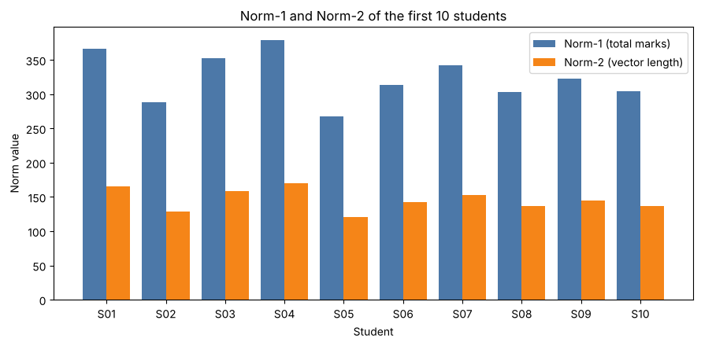
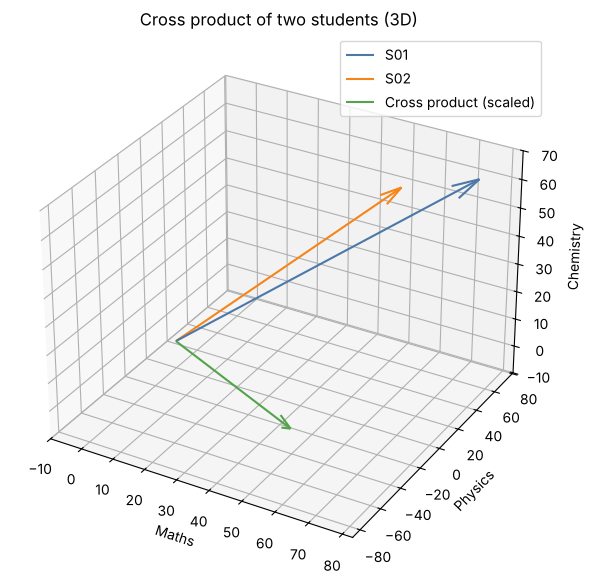
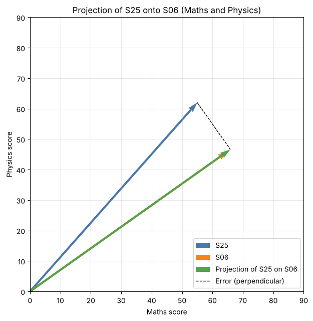
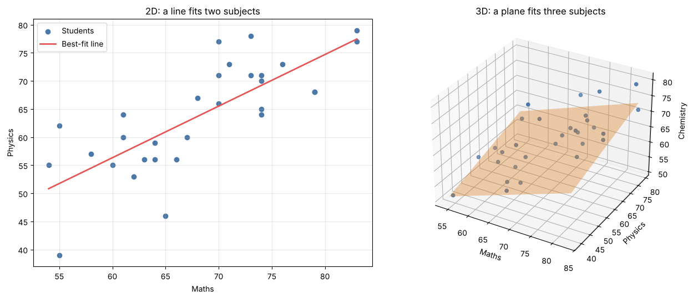
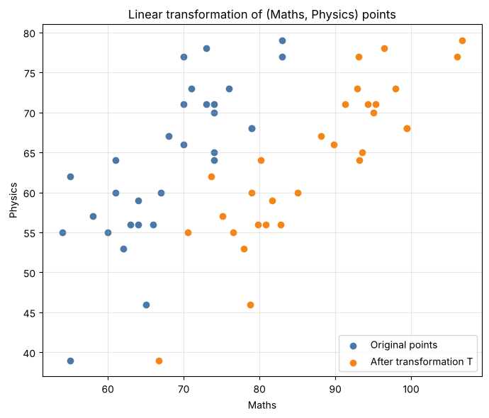
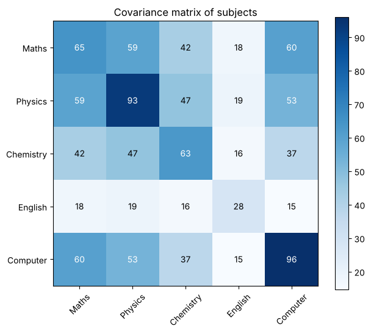
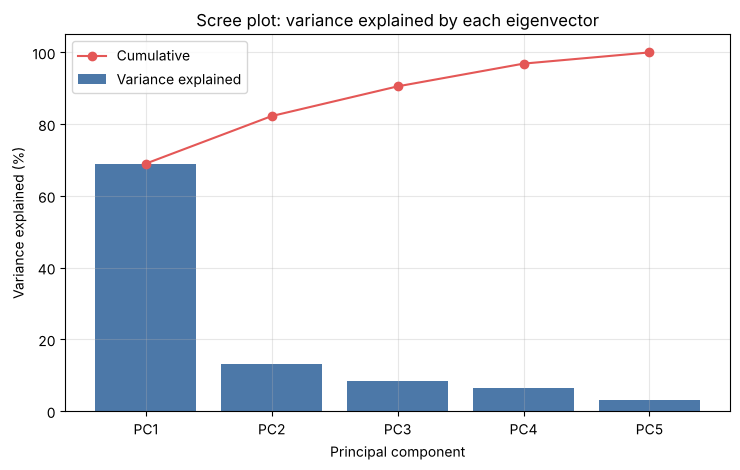
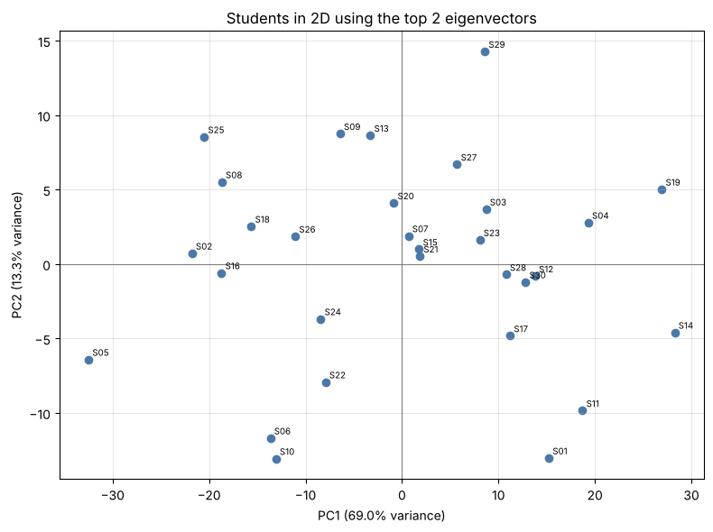

# 📊 Calculative Foundation – Mathematical & Linear Algebra Analysis

<p align="center">
  <strong>A Python-based mathematical analysis project exploring Linear Algebra, Vector Operations, Statistical Relationships, and Principal Component Analysis (PCA) through practical calculations and data visualization.</strong>
</p>

<p align="center">
  
  
  
  
</p>

---

## 📌 Project Overview

**Calculative Foundation** is a Python-based mathematical analysis project designed to explore the fundamental concepts of Linear Algebra and their practical applications in Data Analytics.

The project focuses on understanding mathematical operations, vector calculations, linear transformations, covariance, and dimensionality reduction techniques.

Using Python and Jupyter Notebook, different mathematical concepts are implemented through numerical calculations and graphical visualizations to make complex mathematical ideas easier to understand.

### 🎯 Project Objectives

The project focuses on the following objectives:

1. Understand fundamental Linear Algebra concepts and mathematical operations.
2. Explore vector norms and cross-product calculations.
3. Understand vector projection and geometric relationships.
4. Analyze line and plane fitting techniques.
5. Explore linear transformations and their effects on vectors.
6. Understand covariance and relationships between variables.
7. Apply Principal Component Analysis (PCA) for dimensionality reduction.
8. Visualize mathematical concepts using Python.

---

## 🗂️ Repository Structure

```text
PR-4-Calculative-foundation-/
│
├── Images/
│   ├── 01_norms_bar.png
│   ├── 02_cross_product_3d.png
│   ├── 03_vector_projection.png
│   ├── 04_line_plane_fit.png
│   ├── 05_linear_transformation.png
│   ├── 06_covariance_heatmap.png
│   ├── 07_scree_plot.png
│   └── 08_pca_scatter.png
│
├── Calculative_Foundation.ipynb
├── Linear_Algebra_Theory.pdf
├── student_scores.csv
└── README.md
```

---

## 📁 Dataset Description

**Dataset File:** `student_scores.csv`

The project includes a student scores dataset in CSV format for practical mathematical and data analysis exercises.

The dataset is used as a supporting resource for exploring numerical data and understanding mathematical relationships.

---

## 🧮 Mathematical Analysis & Methodology

The project covers the following mathematical concepts and techniques.

| No. | Analysis | Mathematical Concepts |
|---|---|---|
| 01 | Vector Norms | Vector magnitude and distance measurement |
| 02 | Cross Product | Vector multiplication and 3D geometry |
| 03 | Vector Projection | Projection of one vector onto another |
| 04 | Line & Plane Fitting | Geometric modelling and fitting |
| 05 | Linear Transformation | Matrix operations and vector transformations |
| 06 | Covariance Heatmap | Relationships and dependencies between variables |
| 07 | Scree Plot | Explained variance and component selection |
| 08 | PCA Scatter Plot | Dimensionality reduction and data representation |

### Key Mathematical Concepts

**1. Vector Norms**

Vector norms measure the magnitude or length of a vector. They help calculate distances and understand vector size.

**2. Cross Product**

The cross product calculates a new vector perpendicular to two given vectors in three-dimensional space.

**3. Vector Projection**

Vector projection determines how much one vector extends in the direction of another vector.

**4. Line and Plane Fitting**

Line and plane fitting techniques help represent relationships between data points using mathematical models.

**5. Linear Transformation**

Linear transformations use matrix operations to change the position, direction, or scale of vectors while preserving linear relationships.

**6. Covariance**

Covariance measures how two variables change together. It helps identify positive and negative relationships between variables.

**7. Scree Plot**

A scree plot represents the explained variance of principal components and helps determine how many components should be retained.

**8. Principal Component Analysis (PCA)**

PCA is a dimensionality reduction technique that transforms high-dimensional data into fewer principal components while preserving as much variation as possible.

---

## 📈 Mathematical Visualizations

The following visualizations are generated as part of the project to understand mathematical concepts through graphical representation.

### 01. Vector Norms



### 02. Cross Product (3D)



### 03. Vector Projection



### 04. Line & Plane Fitting



### 05. Linear Transformation



### 06. Covariance Heatmap



### 07. Scree Plot



### 08. PCA Scatter Plot



---

## 🔍 Key Learning Outcomes

Through this project, the following concepts and practical skills are explored:

**1. Mathematical Understanding**

Developed an understanding of fundamental mathematical concepts and their applications in data analysis.

**2. Vector Operations**

Practiced vector norms, cross products, and vector projections using numerical calculations.

**3. Matrix & Linear Algebra**

Explored matrix-based operations and linear transformations.

**4. Statistical Relationships**

Understood covariance and how variables are related to one another.

**5. Dimensionality Reduction**

Explored PCA and the importance of explained variance through scree plots and scatter plots.

**6. Data Visualization**

Developed graphical representations of mathematical concepts using Python.

---

## 🛠️ Technology Stack

| Technology | Purpose |
|---|---|
| Python | Mathematical calculations and programming |
| NumPy | Numerical computations and vector operations |
| Pandas | Dataset handling and manipulation |
| Matplotlib | Mathematical data visualization |
| Seaborn | Statistical visualization |
| Scikit-learn | Machine learning and PCA techniques |
| Jupyter Notebook | Interactive coding and analysis |

---

## 🚀 Installation & Execution

### 1. Clone the Repository

```bash
git clone https://github.com/Darshan-Patil115/PR-4-Calculative-foundation-.git
```

### 2. Navigate to the Project Directory

```bash
cd PR-4-Calculative-foundation-
```

### 3. Create a Virtual Environment (Recommended)

```bash
python -m venv venv
```

Activate it:

**Windows**

```bash
venv\Scripts\activate
```

**macOS / Linux**

```bash
source venv/bin/activate
```

### 4. Install Dependencies

```bash
pip install numpy pandas matplotlib seaborn scikit-learn jupyter
```

### 5. Launch Jupyter Notebook

```bash
jupyter notebook Calculative_Foundation.ipynb
```

Run the notebook cells sequentially to explore the mathematical calculations and visualizations.

---

## 📚 Project Documentation

The repository includes the following learning and practical resources:

- **[Calculative Foundation Notebook](Calculative_Foundation.ipynb)** – Practical implementation of mathematical concepts and Python-based calculations.
- **[Linear Algebra Theory PDF](Linear_Algebra_Theory.pdf)** – Supporting theoretical material for understanding Linear Algebra.
- **[Student Scores Dataset](student_scores.csv)** – CSV dataset included for practical exercises.
- **[Visualization Gallery](Images/)** – Graphical representations of mathematical concepts.

---

## ⚠️ Project Scope

- The project focuses on mathematical foundations and their practical implementation using Python.
- Visualizations are used to support the understanding of mathematical operations.
- PCA and covariance analysis are explored through graphical representations.
- The repository is intended for educational purposes and practical learning.

---

## 🏁 Conclusion

The **Calculative Foundation** project demonstrates how fundamental mathematical concepts can be implemented and visualized using Python.

By exploring vector operations, linear transformations, covariance, and Principal Component Analysis, this project builds a foundation for understanding the mathematical techniques used in Data Analytics and Machine Learning.

It combines mathematical theory, numerical computation, Python programming, and data visualization to develop a practical understanding of Linear Algebra and its real-world applications.

**This project represents an important step toward building strong mathematical foundations for Data Science, Machine Learning, and Data Analytics.**

---

## 👨‍💻 Author

**Darshan Patil**

GitHub: [Darshan-Patil115](https://github.com/Darshan-Patil115)

**Project:** Calculative Foundation – Mathematical & Linear Algebra Analysis (PR-4)

---

<p align="center">
  <strong>⭐ If you find this project useful, consider giving it a star!</strong>
</p>

<p align="center">
  Thank you for visiting my repository!
</p>
